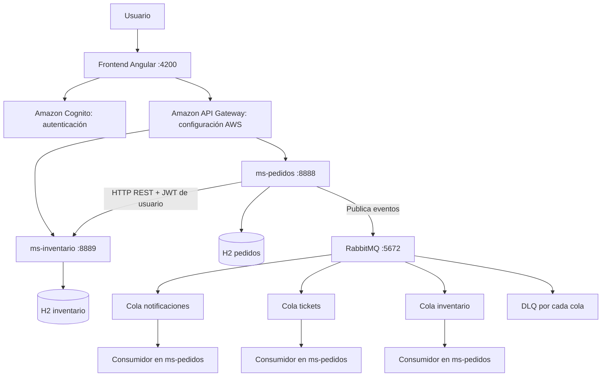

♻️ Eco360 — Gestión de pedidos e inventario de materiales reciclados
Eco360 es una aplicación web académica orientada a la gestión de pedidos e inventario de materiales reciclados. Integra una interfaz en Angular, dos microservicios REST con Spring Boot, autenticación mediante Amazon Cognito y mensajería asíncrona con RabbitMQ.
Contexto: Proyecto desarrollado para actividades de Desarrollo Cloud Native (DSY1107), DUOC UC. La configuración de integración con AWS está incluida en el repositorio; la disponibilidad del despliegue depende del entorno AWS utilizado.

Contenido
- Funcionalidades
- Tecnologías
- Arquitectura
- Estructura del repositorio
- Requisitos
- Ejecución local
- Configuración de seguridad y AWS
- API REST
- RabbitMQ y gestión de errores
- Pruebas sugeridas
- Consideraciones y mejoras futuras
Funcionalidades
Pedidos
- Crear y consultar pedidos de material reciclado.
- Filtrar pedidos por estado.
- Actualizar estados siguiendo transiciones validadas.
- Cancelar pedidos y liberar el stock reservado.
- Eliminar pedidos cancelados o despachados.
Inventario
- Consultar, crear, editar y eliminar materiales.
- Administrar cantidades disponibles y unidades de medida.
- Reservar stock al crear un pedido y liberarlo al cancelarlo.
- Validar datos y rechazar reservas cuando no existe stock suficiente.
Integración y seguridad
- Autenticación de usuarios con AWS Amplify y Amazon Cognito.
- Validación de JWT y autorización por scopes OAuth 2.0 en ambos microservicios.
- Publicación y consumo de eventos con RabbitMQ.
- Confirmación manual de consumo (ACK) y rechazo (NACK) con colas de mensajes fallidos (DLQ).
- Operaciones administrativas de demostración sobre colas, exchanges y bindings mediante API protegida.
Tecnologías
Capa	Tecnologías
Frontend	Angular 19, TypeScript, HTML, CSS, AWS Amplify 6
Backend	Java 17 (configurado), Spring Boot 4.1.1 (declarado en POM), Spring Web MVC, Spring Data JPA
Persistencia	H2 en archivos locales independientes por microservicio
Mensajería	RabbitMQ, Spring AMQP, Docker Compose
Identidad y seguridad	Amazon Cognito, OAuth 2.0, JWT, Spring Security
Integración cloud	Amazon API Gateway y configuración de ejecución en EC2
Herramientas	Maven Wrapper, npm, Git, Postman (opcional)

Arquitectura

Flujo de creación de un pedido:
1. El usuario inicia sesión mediante Cognito y obtiene un token de acceso.
2. El frontend envía la solicitud autenticada a la API configurada.
3. ms-pedidos solicita a ms-inventario la reserva de stock por HTTP REST, reenviando el JWT.
4. Si la reserva tiene éxito, el pedido se guarda en la base H2 de pedidos.
5. Se intenta publicar el evento PEDIDO_CREADO a tres colas RabbitMQ: notificaciones, tickets e inventario.
6. Los consumidores, implementados en ms-pedidos, procesan el evento y envían un ACK o un NACK según el resultado.
Importante: La reserva real del stock ocurre por HTTP entre microservicios. El consumidor de la cola de inventario registra el evento; no vuelve a descontar stock. Si la publicación del evento falla, el pedido ya guardado no se revierte automáticamente.

Estructura del repositorio
eco360-main/
├── README.md
├── pedidos360-backend/
│   ├── docker-compose.yml          # Broker RabbitMQ local
│   ├── pom.xml                     # Agregador Maven
│   ├── ms-pedidos/
│   │   ├── pom.xml
│   │   └── src/main/
│   │       ├── java/               # API, negocio, seguridad y mensajería
│   │       └── resources/application.properties
│   └── ms-inventario/
│       ├── pom.xml
│       └── src/main/
│           ├── java/               # API, lógica y persistencia
│           └── resources/application.properties
└── pedidos360-front/
    ├── package.json
    └── src/app/
        ├── app.ts / app.html / app.css
        ├── app.env.ts              # Parámetros de Cognito/API Gateway
        ├── pedidos-panel.*         # Gestión visual de pedidos
        ├── inventario-panel.*      # Gestión visual de inventario
        └── auth.interceptor.ts     # Token en peticiones HTTP
Requisitos
- JDK 17 según los archivos pom.xml (comprobar compatibilidad efectiva con la versión de Spring Boot declarada).
- Node.js y npm compatibles con Angular 19.
- Docker Desktop con Docker Compose.
- Conectividad a un User Pool de Amazon Cognito configurado.
- Para utilizar el frontend sin modificar sus servicios HTTP: una API Gateway desplegada y accesible, con las rutas de ambos microservicios.
Nota: Docker Compose levanta solo RabbitMQ. El backend y el frontend se ejecutan por separado. La conexión con Cognito sigue siendo necesaria para acceder a las rutas protegidas.

Ejecución local
Desde la raíz del repositorio, abre terminales separadas.
1. Iniciar RabbitMQ
cd pedidos360-backend
docker compose up -d
docker compose ps
- AMQP: localhost:5672
- Consola de administración: http://localhost:15672
- Credenciales de desarrollo local: eco360 / eco360
2. Iniciar ms-inventario
En otra terminal:
cd pedidos360-backend/ms-inventario
./mvnw spring-boot:run
En Windows PowerShell o CMD, utiliza mvnw.cmd spring-boot:run en lugar de ./mvnw. Servicio configurado en http://localhost:8889.
3. Iniciar ms-pedidos
En otra terminal:
cd pedidos360-backend/ms-pedidos
./mvnw spring-boot:run
En Windows, utiliza mvnw.cmd spring-boot:run. Servicio configurado en http://localhost:8888. Este servicio requiere acceso a RabbitMQ e inventario.
4. Iniciar frontend
En otra terminal:
cd pedidos360-front
npm ci
npm start
Abre http://localhost:4200. La interfaz usa las URLs configuradas en src/app/app.env.ts, que actualmente apuntan a API Gateway, no directamente a los puertos locales.
5. Detener RabbitMQ
cd pedidos360-backend
docker compose down
El volumen Docker mantiene los datos del broker. docker compose down -v también elimina ese volumen; úsalo solo si quieres reiniciar su estado.
Configuración de seguridad y AWS
Los datos de Cognito y API Gateway están centralizados en:
pedidos360-front/src/app/app.env.ts
Configura los parámetros del ambiente correspondiente:
export const appEnv = {
  userPoolId: '<USER_POOL_ID>',
  userPoolClientId: '<APP_CLIENT_ID>',
  cognitoDomain: '<DOMINIO_COGNITO_SIN_HTTPS>',
  customScopes: [
    'rs-api-pedidos/pedidos-read',
    'rs-api-pedidos/pedidos-write',
    'rs-api-inventario/inventario-read',
    'rs-api-inventario/inventario-write',
  ],
  apiGatewayBaseUrl: 'https://<API_ID>.execute-api.<REGION>.amazonaws.com/test',
  get pedidosEndpoint() { return `${this.apiGatewayBaseUrl}/api/pedidos`; },
  get inventarioEndpoint() { return `${this.apiGatewayBaseUrl}/api/inventario`; },
  redirectUrl: 'http://localhost:4200',
};
Revisa también en ambos application.properties el valor de spring.security.oauth2.resourceserver.jwt.issuer-uri. En ms-pedidos se configura eco360.inventario.base-url, por defecto http://localhost:8889.

Scopes autorizados:
Recurso	Lectura	Escritura
Pedidos	rs-api-pedidos/pedidos-read	rs-api-pedidos/pedidos-write
Inventario	rs-api-inventario/inventario-read	rs-api-inventario/inventario-write

Los endpoints /api/rabbit-admin/** también requieren el scope de escritura de pedidos. Las pruebas HTTP deben enviar Authorization: Bearer <ACCESS_TOKEN> con los permisos correspondientes. Para crear pedidos se requiere además escritura en inventario, porque el backend reenvía ese token para reservar stock.
app.env.ts contiene identificadores y URLs del ambiente, que no deben confundirse con secretos. Evita publicar contraseñas, secretos de clientes OAuth o tokens reales. Las credenciales RabbitMQ incluidas son exclusivamente para desarrollo y deben cambiarse antes de cualquier exposición pública.

API REST
Pedidos — http://localhost:8888
Método	Ruta	Descripción
GET	/api/pedidos	Lista pedidos; admite ?estado=EN_PROCESO
GET	/api/pedidos/{id}	Obtiene un pedido
POST	/api/pedidos	Crea pedido y reserva inventario
PUT	/api/pedidos/{id}/estado	Cambia estado según reglas del negocio
DELETE	/api/pedidos/{id}	Elimina pedido cancelado o despachado

Ejemplo de creación:
POST /api/pedidos
Authorization: Bearer <ACCESS_TOKEN>
Content-Type: application/json

{"producto":"Cartón","cantidad":5}
Estados del pedido: EN_CLASIFICACION → EN_PROCESO → LISTO_PARA_DESPACHO → DESPACHADO. También se puede cancelar desde los tres primeros estados.

Ejemplo de actualización:
PUT /api/pedidos/1/estado
Authorization: Bearer <ACCESS_TOKEN>
Content-Type: application/json

{"estado":"EN_PROCESO"}
Inventario — http://localhost:8889
Método	Ruta	Descripción
GET	/api/inventario	Lista materiales
GET	/api/inventario/{id}	Consulta un material
POST	/api/inventario	Crea material
PUT	/api/inventario/{id}	Actualiza material
DELETE	/api/inventario/{id}	Elimina material
POST	/api/inventario/reservas	Reserva/descuenta stock
POST	/api/inventario/liberaciones	Libera/devuelve stock

Ejemplo para crear material:
{"producto":"Cartón","stock":100,"unidad":"kg"}
Ejemplo para reservar/liberar:
{"producto":"Cartón","cantidad":5}
Administración RabbitMQ (demostración) — http://localhost:8888
Método	Ruta	Acción
POST / DELETE	/api/rabbit-admin/queues / /api/rabbit-admin/queues/{name}	Crear o eliminar cola
POST / DELETE	/api/rabbit-admin/exchanges / /api/rabbit-admin/exchanges/{name}	Crear o eliminar exchange
POST / DELETE	/api/rabbit-admin/bindings	Crear o eliminar binding

La eliminación de colas y exchanges está restringida mediante validación a nombres que empiecen con demo.. No utilices estas funciones administrativas sin revisar primero los permisos y las restricciones de acceso del ambiente.
RabbitMQ y gestión de errores
El proyecto declara un exchange directo eco360.pedidos.direct y un exchange para mensajes fallidos eco360.dlx.
Cola principal	Cola de mensajes fallidos (DLQ)
eco360.cola.notificaciones	eco360.cola.notificaciones.dlq
eco360.cola.tickets	eco360.cola.tickets.dlq
eco360.cola.inventario	eco360.cola.inventario.dlq

Al crear un pedido, PedidosProducer publica a las tres colas un mensaje de texto con el formato:
PEDIDO_CREADO|<id>|<producto>|<cantidad>
- ACK: el consumidor confirma que procesó el mensaje.
- NACK con requeue=false: el consumidor rechaza el mensaje y RabbitMQ lo dirige a la DLQ configurada.
- Prueba de error: los consumidores generan deliberadamente una excepción cuando el contenido incluye ERROR_TEST. Esto permite demostrar el rechazo y dead-lettering en un laboratorio; no representa un sistema de validación de mensajes de producción.
La topología de colas/exchanges/bindings se declara mediante Spring AMQP al iniciar ms-pedidos. Para observar mensajes y DLQ, utiliza la consola de RabbitMQ.
Pruebas sugeridas
1. Verificar que Docker muestra el contenedor RabbitMQ activo y que se puede abrir su consola web.
2. Iniciar los dos microservicios y comprobar sus logs, incluidas las declaraciones de colas y exchanges.
3. Iniciar sesión en Angular y verificar la presencia de un token con scopes suficientes.
4. Crear un material en inventario y luego generar un pedido que lo utilice.
5. Confirmar que el stock disminuye y el pedido aparece en la lista.
6. Revisar los logs de publicación y consumo de eventos con ACK.
7. Cancelar el pedido y confirmar que el stock se libera.
8. Publicar manualmente un mensaje de prueba con ERROR_TEST en una cola desde la consola de RabbitMQ; comprobar en los logs el NACK y la aparición del mensaje en la DLQ correspondiente.
9. Probar acceso con token ausente o scopes insuficientes para confirmar la protección de las APIs.
Las pruebas anteriores son un procedimiento recomendado, no resultados certificados. No se ejecutaron los servicios ni se verificó aquí el despliegue AWS.

Consideraciones y mejoras futuras
- Disponibilidad del broker: en el diseño actual la creación del pedido puede completar la operación de negocio aunque falle la publicación del evento; se recomienda evaluar un patrón transactional outbox y reintentos controlados.
- Seguridad: usar credenciales RabbitMQ diferentes en ambientes reales, limitar la exposición de puertos y revisar el acceso al módulo administrativo.
- Persistencia: H2 resulta adecuado para pruebas y demostraciones; para producción convendría una base de datos administrada con copias de seguridad.
- Mensajería: implementar consumidores especializados separados si se requiere escalado independiente; actualmente los tres se ejecutan dentro de ms-pedidos.
- Calidad: ampliar pruebas unitarias, de integración y de extremo a extremo, e incluirlas en un pipeline CI.
- Configuración: separar claramente desarrollo local y despliegue cloud mediante perfiles y variables de entorno, sin publicar valores sensibles.
Eco360 demuestra la integración de una aplicación web, APIs REST seguras, coordinación de inventario y mensajería orientada a eventos en un escenario académico de arquitectura cloud native.
